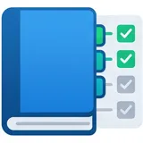
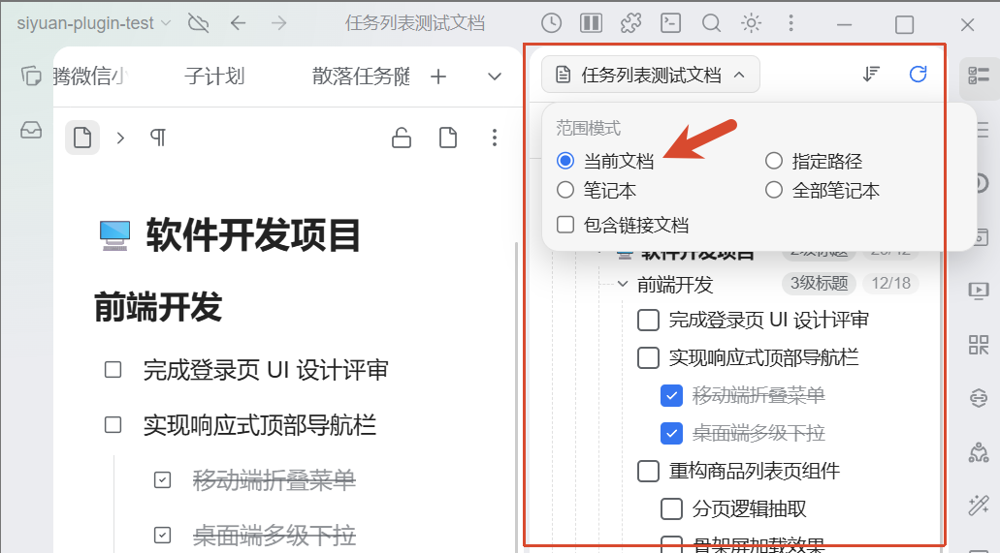
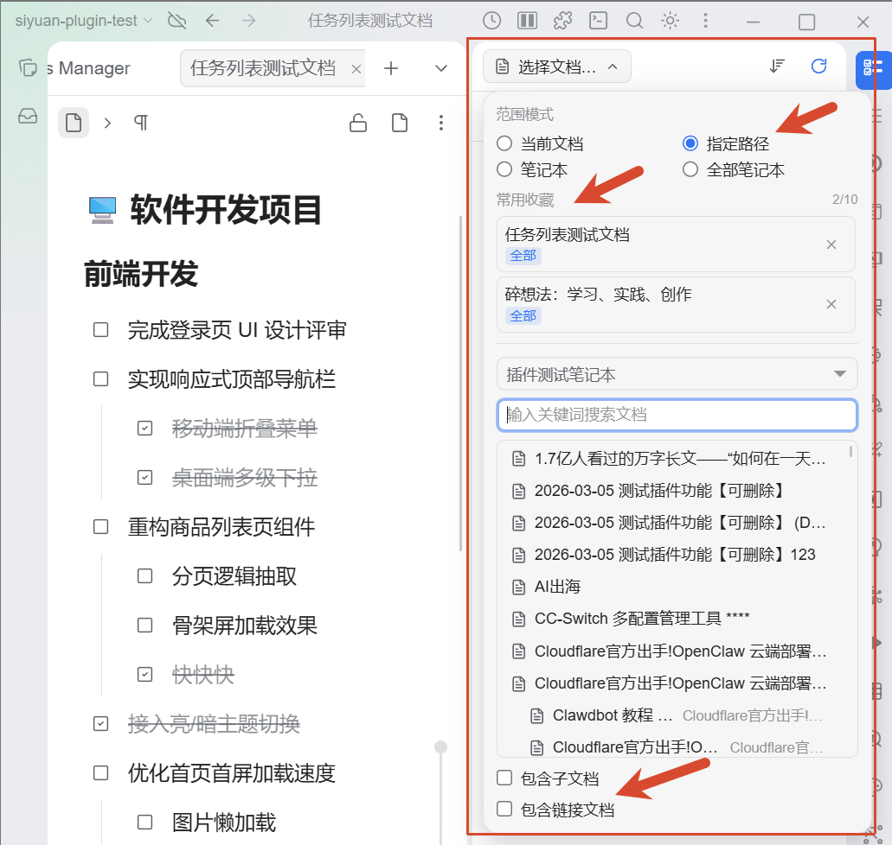
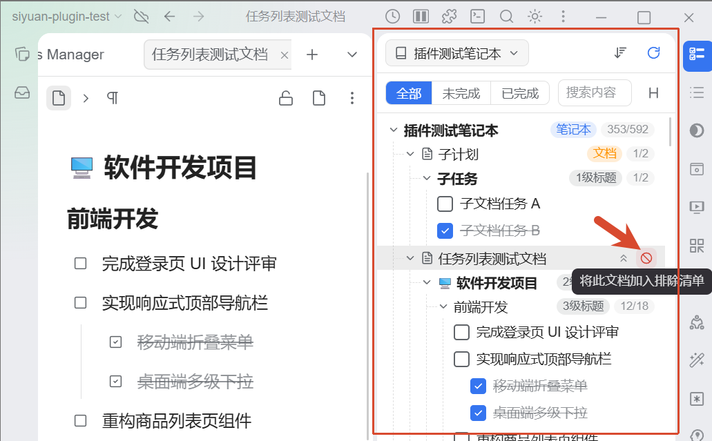
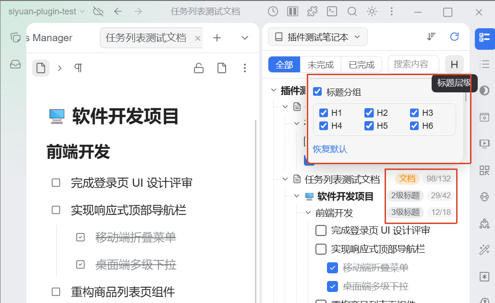
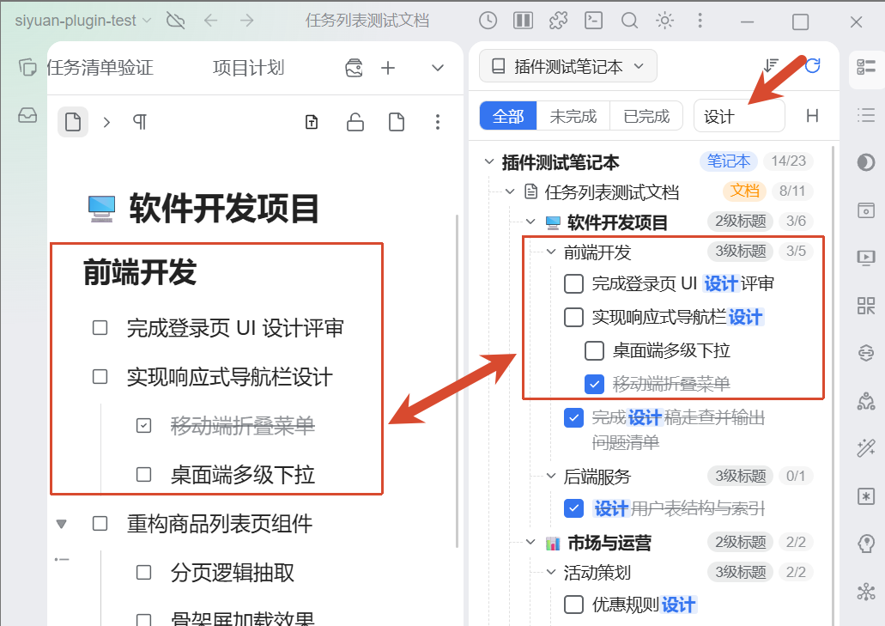

# Gather Scattered Tasks with Ease, Get Things Done — An Introduction to "Task List" (拾事)

  <b>English</b> · <a href="./README_zh_CN.md">简体中文</a>

  
  
  
  

---

## Prologue: Yet Another Task Management Plugin?

There are already quite a few task management plugins in the Bazaar. I have tried several of the most downloaded and acclaimed ones. While they are undoubtedly powerful—some almost establishing an entire project management methodology—the more comprehensive the feature set, the steeper the learning curve. Staring at intricate interfaces and complex configurations can easily deter you from committing to their workflow.

All I really needed was a lightweight **workspace-wide to-do task aggregation plugin**: one that clearly and intuitively displays to-do checklists across the entire notebook vault or for specific project documents, with straightforward status toggling and filtering capabilities.

Renaming tasks? Adding new to-dos? Adding tags? Setting custom attributes? None of these operations belong inside this lightweight aggregation plugin. Whenever edits are needed, simply jump straight to the source document and edit it there. SiYuan Note already provides an exceptionally rich note-taking environment—**note documents should be the sole authoritative source of truth for task information**, without maintaining a redundant, separate data layer.

By avoiding data duplication, the plugin not only lifts the cognitive and operational burden from users, but also ensures bulletproof data permanence—even if the plugin is disabled, uninstalled, or no longer maintained in the future, all your task information remains 100% intact and unaffected in your notes.

‍

## Why Task List (拾事)?

In everyday use of SiYuan Note, checklists (`- [ ] task`) are the most lightweight, natural, and frictionless way to capture action items:

- Ad-hoc action items and assignees in meeting minutes
- Key milestones in project proposals and requirement docs
- Daily priorities and weekly review plans
- Practical exercises and reflections in reading and research notes

However, as notes accumulate across your workspace, this decentralized habit introduces common management headaches:

1. **Scattered & Forgotten, Lacking a Unified Hub**: Tasks are scattered across hundreds or thousands of documents without a centralized bird's-eye view; critical action items easily get forgotten in deep, nested pages.
2. **Decontextualized & Detached, Losing the Original Context**: Stripping tasks down into dry, isolated lines means that days later, you can no longer recall which discussion, proposal, or section background they originated from.

**"Task List" (拾事)** is purpose-built to eliminate these pain points: it sits persistently in your SiYuan sidebar dock as a centralized task aggregation workspace offering **rapid scoping, instant status response, zero-risk document integrity, and contextual outline navigation**. It grants you the confidence of panoramic control alongside the fluidity of piercing straight back into your source notes, achieving a seamless loop between personal knowledge and task execution.

‍

## 5 Core Scenarios & Key Features

### 1. In-Depth Writing & Drafting: Focus on the Present, Write and Review Simultaneously

- **"Current Doc" Mode**: The sidebar dock panel instantly acts as a dedicated task monitor for your active document, **automatically synchronizing** as you open different notes in the editor.
- **Status Sync & Instant Navigation**:
  - Click the checkbox in front of any task to write completion back directly into the source document.
  - Click the task text or the jump icon to smoothly scroll and **flash-highlight** the exact source block in your editor, keeping your writing and proofreading workflow completely uninterrupted.

### 2. Multi-Document Complex Project Tracking: Cross-Document Perspective, 1-Second Board Switching

- **Associated Network Scoping**: Switch to **"Path"** mode and toggle **"Include subdocs"** (`+sub`) and **"Include linked docs"** (`+link`) to effortlessly capture the master document alongside all referenced external tasks, bridging your connected network of knowledge.
- **Favorites**: Save frequent project paths together with their **subdoc/link toggles, heading level filters, and completion status filters** as Favorites (up to 10 entries). Whether it is "Q4 Critical Sprint", "Weekly Standup Tracking", or "Refactoring Initiative", you can **restore the entire project dashboard in one second** from the dropdown menu—no tedious re-configuration required.

### 3. Periodic Workspace-Wide Review: Panoramic Perspective, Smart Noise Reduction

- **Global Sweep**: Select **"Notebook"** or **"All notebooks"** mode to gain an all-encompassing view across your entire knowledge base, clearly separating pending action items from completed ones.
- **1-Click Exclusion**: In the task tree, simply hover over any irrelevant or archived document header and click the **"Exclude"** button to immediately mute that document and all its sub-pages. Easily search and remove exclusions from the dedicated exclusion modal, keeping your periodic reviews sharply focused.

### 4. Complex Multi-Level Sub-Task Tracking: Hierarchical Indentation, Progress at a Glance

- **True Tree Indentation**: Strictly preserves SiYuan's **nested tree indentation** and vertical connecting **guide lines**. Tasks are grouped by **heading hierarchy** by default; if a heading level is deselected, tasks automatically aggregate into the parent heading above.
- **Live Progress Indicators**: The right side of every notebook, document, and heading header persistently displays **`open / total` progress metrics**, allowing you to grasp overall completion at a glance even while filtering with search keywords.

### 5. Mass Task Focused Retrieval: Intelligent Sorting, What You Search Is What You See

- **Sort Open Tasks First**: When "Sort open tasks first" is enabled in plugin settings, uncompleted items within the same list block float to the top while completed ones sink to the bottom. Sibling items strictly preserve their original writing order from the source document without unwanted re-sorting, making priorities immediately apparent.
- **Instant Search with Keyword Highlighting**: Type any keyword in the search bar to filter the task tree immediately; matched text is prominently highlighted in yellow. Press `ESC` or click the clear button to restore the view instantly, pinpointing items in seconds even across thousands of to-dos.

‍

## User Guide

### 1. Top Scope Bar

- **Scope Mode**: Click the left-most mode button to open the dropdown menu and switch swiftly between 4 aggregation scopes: **"Current doc"**, **"Path"**, **"Notebook"**, and **"All notebooks"**.
- **Association Switches (Exclusive to Path Mode)**:
  - Click **`+sub`**: Automatically extends the aggregation scope downward to all child and descendant documents.
  - Click **`+link`**: Automatically parses outgoing references, document links, and embed blocks within the document to gather tasks from all connected notes.
- **★ Favorites**:
  - Click the star icon: Save the currently selected path along with its subdoc/link settings, heading depths, and status filter as a quick Favorite; click again to unfavorite.
  - Open favorites list: Click any saved preset to switch and load its complete dashboard configuration in seconds; individual presets can be cleared or deleted anytime.
- **Excluded Paths Manager**: In Notebook or All notebooks mode, click the shield icon in the top right to inspect and manage your list of excluded documents.
- **Refresh Button**: Manually fetch the latest task data at any time.

### 2. Filter & Search Bar

- **Tri-State Filter**: Tap the capsule pills for "All", "Open", or "Done" to filter your view instantaneously.
- **Real-Time Search**: Type any character into the search box to filter tasks with vibrant yellow keyword highlights; press `ESC` or click the clear button to reset.
- **Heading Level Filtering**:
  - Click the gear icon on the right to open the menu and toggle "Heading groups" on or off.
  - Select only the heading depths you care about (e.g. check only H1 and H2), and deeper subsections (H3~H6) will aggregate upward to their parent heading; deselecting all headings will flatten tasks directly to the document level.

### 3. Group Headers & Task Tree

- **Collapse & Expand**: Click anywhere on a notebook, document, or heading row to expand or fold the group; the plugin automatically remembers your collapse preferences.
- **Hover Quick Actions**: Move your mouse over any document header:
  - Click **Expand / Collapse All**: Fold or unfold all subsections and tasks under that document in one click.
  - Click **Exclude this document**: Instantly exclude that document and all of its sub-pages from the view.
- **Progress Ratio**: Group headers persistently display `open count / total tasks` on the right for transparent progress tracking.

### 4. Task Row Actions

- **Toggle Checkbox**: Click the square checkbox to toggle completion status and safely write back to the source document, backed by smooth optimistic UI updates.
- **Jump & Locate**: Click the task text or the jump icon on the right; the workspace will automatically navigate to that note and perform a **flash-highlight location** on the source block inside the editor.

### 5. Plugin Settings

- **Sort open tasks first**:
  - **Enabled**: Uncompleted tasks within the same list block are automatically prioritized before completed items.
  - **Disabled**: All tasks are strictly displayed in their natural writing order from the document.
- **Aggregation limit**:
  - Set the maximum number of tasks fetched per aggregation query (supports 100 to 100,000 tasks; default is 2,000).

‍

## Frequently Asked Questions (FAQ)

- **Q1: Will checking off tasks in the dock panel break my note layout?**

  No. Task List adopts a "read-only projection" architecture. Other than invoking SiYuan's native atomic task marker update API when you click a checkbox (which only modifies the `- [ ]` and `- [x]` marker characters), it never performs any rewrites or block relocations on your source documents. Even if your task items have nested multi-paragraph text, code blocks, or sub-lists, the original structure remains 100% intact.

- **Q2: How do I hide backlog tasks from templates and archived vaults?**

  In "Notebook" or "All notebooks" scope mode, hover your cursor over the unwanted document header in the task tree and click the **Exclude** button. That document and all of its nested child pages will immediately vanish from your view. You can also view and restore excluded documents at any time via the Excluded Paths modal from the top scope bar.

- **Q3: What documents does "Include linked docs" sweep?**

  When enabled in "Path" mode, the plugin automatically analyzes all **direct block references**, **document links**, and **embed blocks** in the active document's body, bringing in to-dos from those referenced pages. This is especially ideal for workflows organized around a "master project page + supporting reference pages" knowledge graph.

- **Q4: Why does a checked task not flicker back on automatic refresh?**

  SiYuan's kernel database requires a 1–2 second window to re-index modified blocks. Task List features a built-in **optimistic update protection window**: after you check off a task, the UI locks your latest user action during subsequent refreshes until the kernel confirms the new state has taken effect, eliminating annoying state reverts.

‍

## Compatibility & Installation

- **Platform Compatibility**: Windows, macOS, Linux, and Docker (Desktop app and browser).
- **Minimum SiYuan Version**: `v3.8.5` and above.
- **Installation**:
  1. Open SiYuan Note **Settings** → **Bazaar**;
  2. Select the **Plugins** tab and search for **Task List**, **拾事**, or **siyuan-task-list**;
  3. Click **Install** and toggle to enable;
  4. The Task List icon will appear in your right dock panel.

‍

## Feedback & Community

- **Issues & Suggestions**: Feel free to submit questions and feature requests via [GitHub Issues](https://github.com/famotime/siyuan-task-list/issues).
- If **Task List** helps improve your daily productivity and note organization, consider giving it a ⭐️ **Star** on GitHub to show your support!
