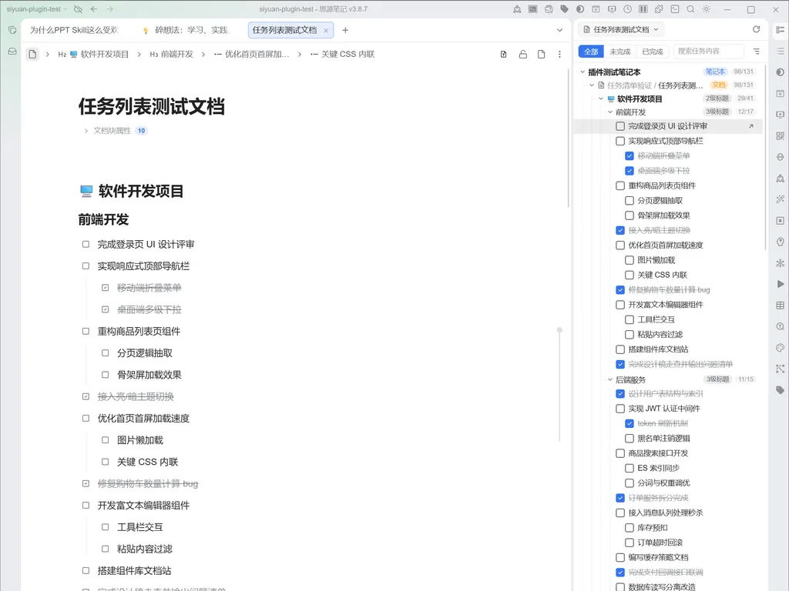

# 拾事 (Task List) - 思源笔记任务清单汇总

  <b>散落任务随手拾，归拢手边事事办</b>

  <a href="./README.md">English</a> · <b>简体中文</b>

  

---

## 💡 为什么需要「拾事」？

在思源笔记中，我们常常随手在各处记录待办事项（`- [ ] 任务`）：会议记录里的临时待办、周报规划里的重点行动、项目文档中的执行清单、读书笔记里的实践任务……

然而，随着文档越来越多，这种分散记录的方式带来了新的困扰：
- 🔍 **任务分散易遗漏**：待办碎片隐藏在成百上千个文档深处，没有统一出口，重要事项常常被遗忘在某个角落。
- 🧭 **脱离语境难理解**：很多第三方待办工具只抽出一行干瘪的文字，脱离了原文档的章节标题和前因后果，时间一长根本想不起任务因何而来。
- 🔒 **担心误改原文档**：许多聚合工具在排序或批量操作时，容易破坏原本精心排版的列表结构，甚至意外改写内容。

**「拾事」正是为此而生**：它在右侧 Dock 面板中为您构建一个**即时、安全、结构化**的任务全景视图。既能全局把控，又能瞬间定位原文，让任务管理与知识笔记浑然一体。

---

## 🎯 典型使用场景

### 1. 长文/方案撰写：专注当下，边写边查
- **场景**：正在编写复杂的项目方案、需求说明书或长篇会议纪要，文中穿插了许多待办项。
- **价值**：一键切换到**「当前文档」**模式，侧边栏实时汇集本文所有待办。勾选任务即可直接回写文档；点击任务瞬间跳转并**高亮闪烁定位**原段落，注意力始终停留在当前写作流中。

### 2. 专项项目推进：跨文档协同，一键切换看板
- **场景**：一个项目往往包含一份主文档、若干层级子文档以及通过块引用/嵌入块关联的参考文档。
- **价值**：
  - 切换到**「指定路径」**模式，支持自由勾选**「包含子文档」**与**「包含链接文档」**，轻松把整个项目体系的任务网罗殆尽。
  - **常用收藏（Favorites）**：将高频使用的项目路径连同其筛选条件（子文档/链接开关、状态筛选、标题层级）一键保存到**常用收藏**（最多支持 10 个）。日常在“重点攻坚项目”、“每周例会跟踪”等看板间一键秒级切换，再也无需每次重复配置。

### 3. 周期性全库复盘：全局巡检，智能过滤干扰
- **场景**：在周末、月底或季度规划复盘时，需要全景排查未完事项。
- **价值**：
  - 选择**「笔记本」**或**「全部笔记本」**模式，全盘透视知识库积压任务。
  - **排除路径（Exclude Paths）**：历史归档、模板库、日记草稿里的待办无需再干扰视线！不仅可在设置中配置排除路径，更可在面板中直接将无关文档**悬浮一键加入排除清单**，让任务视图始终干净聚焦。

### 4. 复杂任务追踪：父子层级清晰，进度一目了然
- **场景**：项目包含多层级子任务，或者多个章节模块各自有独立进度。
- **价值**：
  - 任务树还原多层**子任务缩进**与层级连接线，同时支持思源原生的各种自定义任务标记（如 `[-]`、`[/]` 等状态标记）。
  - 分组头实时计算显示该分支的**完成进度（未完成数 / 总数）**，项目推进情况尽在掌握。

---

## ✨ 核心优势与特色功能

### 🛡️ 纯只读投影机制，数据绝对安全
- 面板始终是原文档的“只读投影”，任何筛选、搜索、折叠或显示重排均**绝不改写原文档的块顺序与段落排版**。
- 唯一的回写动作是通过思源底层专用接口更新勾选标记，即便任务项下挂载复杂的嵌套子列表或注释，也能完整无损保留。

### 🌲 深度语境归类：笔记本 → 文档 → 标题树 → 任务簇
- 拒绝割裂的扁平清单！严格按照真实文档脉络组织任务，保留完整的章节标题语境（H1～H6 标题层级）。
- **标题层级过滤**：支持自定义展示关心的标题深度（如只看 H1/H2），或直接平铺到文档层，自由掌控信息密度。
- **一键全部展开/折叠**：文档分组悬浮快捷工具，一键收放该文档下的所有章节与任务簇，轻松应对海量任务。

### ⚡ 智能排序与流畅交互
- **未完成任务优先置顶**：同一列表块内，未完成任务自动聚合排在上方，已完成任务沉底，且同状态下严格保留原文档中的先后顺序，一眼看清手头待办。
- **三态筛选与实时搜索**：支持「全部 / 未完成 / 已完成」一键切换；配合实时关键词搜索，命中文字自动高亮显示。
- **实时双向防抖同步**：在编辑器中修改或保存文档时，面板自动防抖刷新；在面板中勾选任务，编辑器即刻同步更新。

---

## 📖 交互快速指引

| 操作区域 | 功能说明 |
| :--- | :--- |
| **顶部范围条 (ScopeBar)** | 点击左侧胶囊切换 4 种范围模式（当前文档 / 指定路径 / 笔记本 / 全部笔记本）；点击星号按钮一键收藏当前路径与筛选条件。 |
| **筛选与搜索条 (FilterBar)** | 左侧切换「全部/未完成/已完成」；中间输入关键词实时搜索高亮；右侧菜单自定义「标题层级开关与 H1-H6 勾选」。 |
| **文档与分组头部** | 点击折叠/展开；右侧常驻显示任务进度（未完成/全部）；悬浮工具栏支持**一键全部展开/折叠**以及**一键加入排除清单**。 |
| **任务行 (TaskRow)** | 点击前方勾选框：切换完成状态并精准写回文档；点击任务文字或右侧跳转图标：跳转并高亮闪烁定位原块。 |

---

## ⚙️ 插件设置

在思源笔记「设置」→「集市」/「插件」→「拾事」中，可根据使用习惯调整：
- **未完成任务排序靠前**：开启后，同级列表块中的未完成项优先展示在已完成项前；关闭时严格保持文档原始顺序。
- **汇总条数上限**：单次汇集的最大任务条数（默认 2000，支持最高至 100000），规避思源内核默认查询截断限制，超量时界面会贴心提示。

---

## 🔌 兼容性与安装

- **兼容版本**：思源笔记 `v3.8.5` 及以上版本。
- **安装方式**：
  1. 打开思源笔记「设置」→「集市」；
  2. 搜索「拾事」或「siyuan-task-list」；
  3. 点击「安装」并启用，即可在右侧 Dock 栏看到「拾事」图标。

---

## 💬 反馈与交流

- **问题反馈与建议**：欢迎在 [GitHub Issues](https://github.com/famotime/siyuan-task-list/issues) 提交反馈与讨论。
- 如果「拾事」帮助您提升了日常工作与笔记管理效率，欢迎在 GitHub 上点个 ⭐️ **Star** 支持一下！
