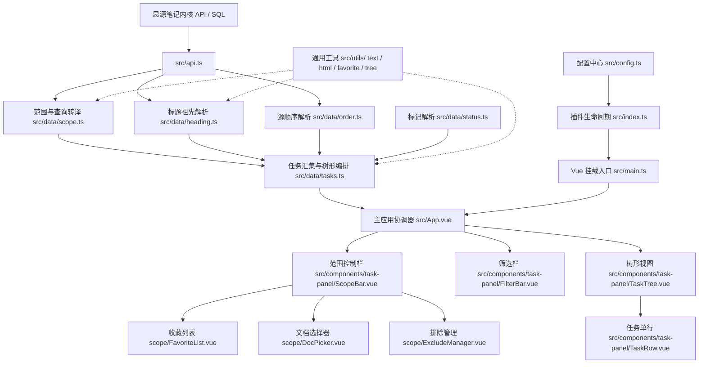

# 项目架构与模块结构指南 (Project Structure)

## 1. 架构概览

`siyuan-task-list`（拾事）是专为思源笔记打造的任务聚合插件。其核心设计遵循**“安全只读投影 (Read-Only Projection)”**与**“分层解耦”**原则：
- **数据层与算法纯粹性**：所有的树形拓扑计算、文档序排列、标题归属链路回溯、SQL 谓词拼装以及排除路径解析均与 UI 解耦，并剥离任何 DOM 浏览器强依赖。
- **UI 模块化组件树**：UI 层拆解为状态控制栏（ScopeBar）、过滤搜索栏（FilterBar）、树形展示容器（TaskTree）与任务单行渲染（TaskRow），各面板内部职责单一独立。

---

## 2. 目录与模块清单

### 2.1 根目录核心文件

- `src/index.ts`：插件生命周期类 `TaskListPlugin`。负责图标注册、Dock 面板同步注册、存储变更监听（`onDataChanged`）与原生设置项弹窗。
- `src/main.ts`：Vue 应用实例化与 Dock 挂载/卸载桥梁（`mountPanel`, `unmountPanel`, `usePlugin`）。
- `src/config.ts`：插件配置模型与数据校验模块。定义 `TaskListConfig`、`DEFAULT_CONFIG`，并提供无副作用的 `sanitizeConfig` 边界校验纯函数。
- `src/api.ts`：思源笔记内核 HTTP API 封装（Notebook、Block、Outline、SQL、Notification）。
- `src/index.scss`：插件主题样式与各组件样式定义。

### 2.2 领域与数据层 (`src/data/`)

- `src/data/types.ts`：领域核心类型定义（`TaskItem`, `HeadingNode`, `TaskGroup`, `ScopeSelection`, `PathFavorite`, `StatusFilter` 等）。
- `src/data/status.ts`：任务标记解析纯函数（`parseTaskLine`, `parseTaskMarker`, `isTaskDone`, `markerForStatus`）。
- `src/data/heading.ts`：沿 `parent_id` 祖先链回溯并结合文档大纲计算层级顺序（`resolveHeadingPaths`, `levelOf`）。
- `src/data/order.ts`：获取块在文档中的 AST 绝对文档序（`resolveDocBlockOrders`），支持 Kramdown 降级兜底。
- `src/data/scope.ts`：汇总范围转译为 SQL 查询（`buildTaskQuery`）、排除路径解析与规范化（`parseExcludePath`, `normalizeExcludePaths`）。
- `src/data/tasks.ts`：任务生命周期取数编排（`collectTasks`）、局部任务树嵌套排序（`buildAndSortTaskTree`）、分组树组装与空组剪枝（`buildTaskGroups`）。

### 2.3 工具库 (`src/utils/`)

- `src/utils/html.ts`：环境无关的 HTML 标签剥除与实体解码工具（`stripHtml`, `decodeHtmlEntities`），无需任何浏览器 DOM。
- `src/utils/text.ts`：安全 HTML 转义、搜索关键词规范化与多处匹配高亮工具（`escapeHtml`, `normalizeKeyword`, `highlightText`）。
- `src/utils/favorite.ts`：收藏项匹配检查与数组无序相等比较（`isFavoriteMatching`, `arraysEqual`）。
- `src/utils/tree.ts`：树形分组递归遍历与键收集工具（`collectGroupKeys`）。

### 2.4 UI 组件层 (`src/components/`)

- `src/App.vue`：上帝状态协调器。管理全局响应式状态、WebSocket 变动监听、任务勾选乐观更新与回滚保护、跨文档跳转与闪烁定位。
- `src/components/_shared/`：
  - `TlIcon.vue`：SVG 矢量图标渲染。
  - `TlPopover.vue`：基于 Teleport 的轻量浮层定位与边界自适应弹窗。
- `src/components/task-panel/`：
  - `ScopeBar.vue`：范围控制栏顶层容器与 Chip 摘要展示。
  - `FilterBar.vue`：三态过滤（全部/未完成/已完成）、搜索输入框与标题层级选择器。
  - `TaskTree.vue`：递归树形视图容器，支持多级折叠与展开全部。
  - `TaskRow.vue`：任务项单行组件，呈现自定义标记与实时关键词高亮。
- `src/components/task-panel/scope/`：
  - `DocPicker.vue`：可复用的笔记本内文档搜索选择器（支持上下键无障碍导航）。
  - `FavoriteList.vue`：常用路径与筛选条件收藏项列表及管理。
  - `ExcludeManager.vue`：文档排除路径清单管理与排除文档选择器。

---

## 3. 测试架构与测试套件 (`tests/`)

项目采用 [Vitest](https://vitest.dev/) 构建全量自动化单元测试体系，测试套件位于 `tests/`：

| 测试文件 | 覆盖模块 | 测试要点 |
| :--- | :--- | :--- |
| `tests/status.test.ts` | `src/data/status.ts` | 标准与自定义标记匹配、完成状态判定与标记字符映射。 |
| `tests/utils/html.test.ts` | `src/utils/html.ts` | 嵌套标签剥除、HTML 实体解码、空边界防御。 |
| `tests/utils/text.test.ts` | `src/utils/text.ts` | 特殊字符转义、关键字高亮、首尾空格与大小写不敏感匹配。 |
| `tests/utils/favorite.test.ts` | `src/utils/favorite.ts` | 收藏状态比对、数组无序相等判定。 |
| `tests/utils/tree.test.ts` | `src/utils/tree.ts` | 分组树 DFS 深度优先遍历与 key 收集。 |
| `tests/config.test.ts` | `src/config.ts` | 边界值截断（100~100000）、标题层级合法化、收藏项数量限制。 |
| `tests/data/heading.test.ts` | `src/data/heading.ts` | 标题层级推导、多级标题祖先链回溯与树形结构构建。 |
| `tests/data/scope.test.ts` | `src/data/scope.ts` | 排除路径格式化、单/多笔记本路径推导、各模式 SQL 语句生成。 |
| `tests/data/tasks.test.ts` | `src/data/tasks.ts` | 嵌套任务树深度与排序、未完成任务优先、跨级标题上浮、计数汇总与空组剪枝。 |
| `tests/__mocks__/siyuan.ts` | `siyuan` 类型包 Mock | 模拟思源环境运行时基础类与方法，保障 Node 测试无缝执行。 |

---

## 4. 关键设计决策与不变式约束

1. **只读投影保障**：除用户显式点击复选框调用 `updateTaskListItemMarker` 外，插件不进行任何写库操作，绝不修改用户源文档结构与顺序。
2. **显式 LIMIT 防截断**：内核 SQL 查询默认按 64 条截断；汇总查询必须显式指定外层 `LIMIT`，并依据返回元信息展示友好截断提示。
3. **乐观更新与 6 秒索引延迟保护**：任务勾选后即时响应视图重排；并在 `pendingConfirm` 缓存中保留 6 秒预期状态，避免内核重索引延迟导致状态回滚。
4. **无 DOM 数据依赖**：`src/data/` 与 `src/utils/` 下所有算法逻辑禁止调用浏览器宿主专属 API（如 `document.createElement`），确保纯算法层可在任何环境直接单测。
