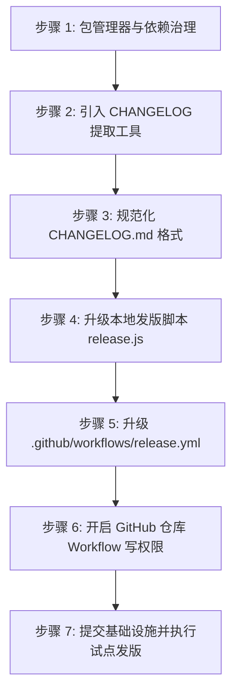

# 存量插件项目接入自动化发版流水线改造指南

本文档总结自 **思源邮递员（siyuan-postman）** 插件接入自动化发版流水线的完整实战与避坑复盘，旨在为后续维护的**其他存量思源笔记插件项目**提供标准、可复制的改造升级 SOP（标准作业程序）。

---

## 一、改造目标与收益

通过本改造，存量插件项目将获得以下现代化工程能力：
1. **CHANGELOG 驱动版本号（Single Source of Truth）**：只需在 `CHANGELOG.md` 顶部写好新版本说明，发版脚本自动将版本号同步到 `plugin.json` 和 `package.json`。
2. **全自动云端打包与 Release 生成**：推送 Tag 后，GitHub Actions 自动提取 CHANGELOG 对应段落作为 Release Notes，编译生成符合思源集市规范的 `package.zip` 并上传资产。
3. **依赖治理与防误触拦截**：彻底移除遗留的 `package-lock.json`，统一采用 `pnpm` 并锁定 `pnpm-lock.yaml`，通过 `preinstall` 钩子拦截误用 `npm`。
4. **规范化提交与安全预检**：本地发版前自动检测 CHANGELOG 是否撰写，避免空日志流入生产；自动生成结构化 Git Commit。

---

## 二、存量插件常见痛点与避坑速查（必读）

在改造存量插件前，请务必注意以下经过实战检验的高频“坑点”：

| 序号 | 常见问题 / 报错现象 | 根因剖析 | 正确对策 |
| :--- | :--- | :--- | :--- |
| **坑 1** | GitHub Actions 报错：`Error 403: Resource not accessible by integration` | GitHub 仓库默认将内置 `GITHUB_TOKEN` 限制为只读权限，无权创建 Release。 | **必须在 GitHub 网页端手动开启一次**：仓库的 `Settings` -> `Actions` -> `General` -> `Workflow permissions` 勾选 **Read and write permissions**。 |
| **坑 2** | GitHub Actions 报错：`Error: Multiple versions of pnpm specified` | `package.json` 声明了 `packageManager: pnpm@...`，而 `release.yml` 的 `action-setup` 中又写了 `version: 10`，导致版本定义冲突。 | **在 `release.yml` 中切勿指定 `version`**，仅保留 `run_install: false`，全自动由 `package.json` 的 `packageManager` 声明托管。 |
| **坑 3** | 改完工作流后直接发版，GitHub 跑的依然是旧版 Action 甚至报错 | 发版脚本 `release.js` 仅负责提交版本相关文件，改造的基础设施代码仍停留在本地，未合入远程主干。 | **发版前必须先提交基础设施**：先执行 `git add . && git commit -m "chore(workflow): ..." && git push`，确保远程 `main` 分支拥有最新工作流，再执行发版。 |
| **坑 4** | 存量项目运行 `pnpm run typecheck` 抛出一堆历史类型错误 | 部分早期插件未配置完整 Vue 声明或使用了宽松编译，强行运行 `tsc` 会阻断发版。 | 在 `release.yml` 中采用 `pnpm run --if-present typecheck`（仅当定义了脚本且有要求时运行），避免阻断编译正常但在类型上历史欠债的代码。 |
| **坑 5** | `.gitignore` 误忽略了 `pnpm-lock.yaml` | 早期模板中可能将 `pnpm-lock.yaml` 列入忽略，导致 CI 阶段 `pnpm install --frozen-lockfile` 找不到锁文件。 | 从 `.gitignore` 中移除 `pnpm-lock.yaml`，并加入 `*.zip` 和 `package.zip` 忽略。 |
| **坑 6** | Bazaar 自动索引报错 `stage-fail`：`package.zip 内有 X 个以 . 开头的条目`（如 `node_modules/xxx/.gitattributes`、`.ncurc.js`、`.prettierrc.js`、`.DS_Store` 等） | 思源的数据同步机制会默认忽略除 `data/.siyuan` 外所有以 `.` 开头的文件和目录；若分发包包含此类条目，多端同步将不一致，Bazaar 自动索引机器人会硬性拦截阻断更新（参考 Bazaar Issue #2338）。 | **必须实施三层防御**：<br>1. **源头排除**：`viteStaticCopy` 复制依赖时，切勿整目录粗暴拷贝，仅精准复制运行时必需的 `lib/`、`package.json` 等；<br>2. **打包过滤**：在 `vite.config.ts` 的 `zipPack` 插件配置 `filter: (fileName) => !fileName.startsWith(".")` 兜底拦截；<br>3. **本地与 CI 门禁**：引入 `scripts/verify-package.mjs`，在 `pnpm build` 及 GitHub Actions CI 中自动解包扫描，发现点文件直接报错阻断。 |

---

## 三、标准化改造操作流程（SOP）

改造一个存量插件项目，共分为 **7 个标准步骤**：



---

### 步骤 1：包管理器与依赖治理

1. **删除冗余锁文件与历史产物**：
   在存量项目根目录下删除 `package-lock.json` 及可能遗留的 `package.zip`：
   ```powershell
   Remove-Item package-lock.json, package.zip -Force -ErrorAction SilentlyContinue
   ```

2. **更新 `.gitignore`**：
   打开 `.gitignore`，检查并执行两处调整：
   - 🔴 **移除**：`pnpm-lock.yaml`（必须纳入版本控制）；
   - 🟢 **追加**：忽略构建生成的压缩包：
     ```gitignore
     *.zip
     package.zip
     ```

3. **更新 `package.json`**：
   在 `package.json` 中补全包管理器声明与快捷脚本：
   ```json
   {
     "scripts": {
       "dev": "vite build --watch",
       "release": "node ./release.js",
       "release:changelog": "node ./release.js --mode=changelog",
       "release:manual": "node ./release.js --mode=manual",
       "release:patch": "node ./release.js --mode=patch",
       "release:minor": "node ./release.js --mode=minor",
       "release:major": "node ./release.js --mode=major",
       "build": "vite build && node ./scripts/verify-package.mjs",
      "verify:package": "node ./scripts/verify-package.mjs",
       "changelog:extract": "node ./scripts/extract-changelog.mjs",
       "preinstall": "npx --yes only-allow pnpm"
     },
     "packageManager": "pnpm@10.18.3",
      "devDependencies": {
        "jszip": "^3.10.1"
      }
   }
   ```

4. **刷新并锁定依赖**：
   运行一次 `pnpm install` 确保锁文件生成且依赖完整：
   ```bash
   pnpm install
   ```

---

### 步骤 2.1：引入 CHANGELOG 提取核心工具

在项目根目录下新建 `scripts/extract-changelog.mjs`，该脚本负责在本地发版时感知最新版本，并在 CI 阶段提取 Release Notes：

```javascript
import fs from 'node:fs'
import path from 'node:path'
import process from 'node:process'
import { fileURLToPath } from 'node:url'

const __dirname = path.dirname(fileURLToPath(import.meta.url))
const rootDir = path.resolve(__dirname, '..')

function parseArgs() {
  const args = process.argv.slice(2)
  let targetTag = ''
  let outFile = ''
  let changelogPath = path.join(rootDir, 'CHANGELOG.md')

  for (let i = 0; i < args.length; i++) {
    const arg = args[i]
    if (arg === '--out' || arg === '-o') {
      outFile = args[++i]
    } else if (arg === '--file' || arg === '-f') {
      changelogPath = path.resolve(process.cwd(), args[++i])
    } else if (!arg.startsWith('-') && !targetTag) {
      targetTag = arg
    }
  }

  if (!targetTag && process.env.GITHUB_REF_NAME) {
    targetTag = process.env.GITHUB_REF_NAME
  }

  return { targetTag, outFile, changelogPath }
}

export function getLatestChangelogVersion(content) {
  const lines = content.split(/\r?\n/)
  const versionHeaderRegex = /^##\s+(?:\[(.*?)\]|([^\s-]+))(.*)$/

  for (const line of lines) {
    if (line.startsWith('## ')) {
      const match = line.match(versionHeaderRegex)
      if (match) {
        const rawVersion = (match[1] || match[2]).trim()
        const cleanVersion = rawVersion.replace(/^v/, '')
        if (/^\d+\.\d+\.\d+(?:-[a-zA-Z0-9.-]+)?$/.test(cleanVersion)) {
          return {
            raw: rawVersion,
            version: cleanVersion,
            tag: `v${cleanVersion}`,
            lineText: line,
          }
        }
      }
    }
  }
  return null
}

export function extractReleaseNotes(content, targetVersion) {
  const normalizedInput = targetVersion.replace(/^refs\/tags\//, '')
  const cleanVersion = normalizedInput.replace(/^v/, '')

  const lines = content.split(/\r?\n/)
  const versionHeaderRegex = /^##\s+(?:\[(.*?)\]|([^\s-]+))(.*)$/

  let isCapturing = false
  const capturedLines = []
  const availableVersions = []

  for (let i = 0; i < lines.length; i++) {
    const line = lines[i]

    if (line.startsWith('## ')) {
      const match = line.match(versionHeaderRegex)
      const versionText = (match ? (match[1] || match[2]) : line.replace(/^##\s+/, '')).trim()
      const currentVersion = versionText.replace(/^v/, '')
      availableVersions.push(versionText)

      if (isCapturing) {
        break
      }

      if (
        currentVersion === cleanVersion ||
        versionText === normalizedInput ||
        versionText.startsWith(`v${cleanVersion}`) ||
        versionText.startsWith(cleanVersion)
      ) {
        isCapturing = true
        continue
      }
    } else if (isCapturing) {
      capturedLines.push(line)
    }
  }

  const result = capturedLines.join('\n').trim()

  return {
    notes: result,
    found: isCapturing && result.length > 0,
    availableVersions,
  }
}

function main() {
  const { targetTag, outFile, changelogPath } = parseArgs()

  if (!targetTag) {
    console.error('❌ 错误: 未指定目标版本 Tag！')
    console.error('用法: node scripts/extract-changelog.mjs <tag> [--out <output-file>]')
    process.exit(1)
  }

  if (!fs.existsSync(changelogPath)) {
    console.error(`❌ 错误: CHANGELOG 文件未找到: ${changelogPath}`)
    process.exit(1)
  }

  const changelogContent = fs.readFileSync(changelogPath, 'utf8')
  const { notes, found, availableVersions } = extractReleaseNotes(changelogContent, targetTag)

  if (!found) {
    console.error(`❌ 错误: 在 CHANGELOG.md 中未找到版本 [${targetTag}] 的更新日志或内容为空！`)
    console.error(`💡 CHANGELOG.md 中已存在的版本标题: ${availableVersions.length > 0 ? availableVersions.join(', ') : '无'}`)
    console.error('📌 请确认 CHANGELOG.md 符合规范，例如包含: ## [v1.0.0] - 2026-10-13')
    process.exit(1)
  }

  if (outFile) {
    const fullOutPath = path.resolve(process.cwd(), outFile)
    fs.writeFileSync(fullOutPath, `${notes}\n`, 'utf8')
    console.log(`✅ 成功提取 [${targetTag}] 更新日志至文件: ${fullOutPath}`)
  } else {
    console.log(notes)
  }
}

if (process.argv[1] && fileURLToPath(import.meta.url) === path.resolve(process.argv[1])) {
  main()
}
```

---

---

### 步骤 2.2：引入产物合规自动化校验工具（Bazaar 避坑红线）

思源社区集市（Bazaar）自动索引对分发包有硬性要求：**严禁包含以 `.` 开头的文件或目录**（如 `.gitattributes`、`.prettierrc.js`、`.DS_Store` 等，参考 Bazaar Issue #2338）。
为确保在本地构建及云端 CI 中能主动阻断该问题，在 `scripts/verify-package.mjs` 中加入自动化校验脚本：

```javascript
import fs from 'node:fs'
import path from 'node:path'
import process from 'node:process'
import AdmZip from 'jszip'

async function verifyPackage() {
  const zipPath = path.resolve(process.cwd(), 'package.zip')
  const distPath = path.resolve(process.cwd(), 'dist')
  let hasError = false
  console.log('\x1B[36m🔍 开始校验插件构建产物与 package.zip...\x1B[0m')

  if (!fs.existsSync(distPath)) {
    console.error('\x1B[31m❌ 错误: dist 目录不存在，请先执行构建\x1B[0m')
    process.exit(1)
  }

  function checkDirForDotFiles(dir) {
    const entries = fs.readdirSync(dir, { withFileTypes: true })
    const dotEntries = []
    for (const entry of entries) {
      if (entry.name.startsWith('.')) dotEntries.push(path.join(dir, entry.name))
      if (entry.isDirectory()) dotEntries.push(...checkDirForDotFiles(path.join(dir, entry.name)))
    }
    return dotEntries
  }

  const distDotFiles = checkDirForDotFiles(distPath)
  if (distDotFiles.length > 0) {
    hasError = true
    console.error('\x1B[31m❌ 错误: dist 目录中包含以点开头的文件或目录:\x1B[0m')
    for (const file of distDotFiles) console.error(`   - ${path.relative(distPath, file)}`)
  }

  if (!fs.existsSync(zipPath)) {
    console.error('\x1B[31m❌ 错误: package.zip 不存在\x1B[0m')
    process.exit(1)
  }

  const zipData = fs.readFileSync(zipPath)
  const zip = await AdmZip.loadAsync(zipData)
  const zipEntries = Object.keys(zip.files)
  const zipDotEntries = zipEntries.filter((entry) => {
    const parts = entry.split('/').filter(Boolean)
    return parts.some((part) => part.startsWith('.') && part !== '.' && part !== '..')
  })

  if (zipDotEntries.length > 0) {
    hasError = true
    console.error('\x1B[31m❌ 错误: package.zip 中检测到以点开头的条目 (思源集市规范禁止):\x1B[0m')
    for (const entry of zipDotEntries) console.error(`   - ${entry}`)
  }

  const requiredFiles = ['plugin.json', 'index.js']
  const missingFiles = requiredFiles.filter((req) => !zipEntries.includes(req))
  if (missingFiles.length > 0) {
    hasError = true
    console.error('\x1B[31m❌ 错误: package.zip 缺少必要文件:\x1B[0m')
    for (const missing of missingFiles) console.error(`   - ${missing}`)
  }

  if (hasError) {
    console.error('\n\x1B[31m💥 构建产物校验失败，请检查并移除违规文件后再发布！\x1B[0m')
    process.exit(1)
  }
  console.log(`\x1B[32m✅ 产物校验通过: package.zip 共 ${zipEntries.length} 个条目，无任何隐藏点文件，符合思源集市规范！\x1B[0m\n`)
}

verifyPackage().catch((err) => {
  console.error('\x1B[31m❌ 校验过程发生异常:\x1B[0m', err)
  process.exit(1)
})
```

同时，在 `vite.config.ts` 中为 `zipPack` 配置过滤器，杜绝隐藏文件打包：
```typescript
zipPack({
  inDir: "./dist",
  outDir: "./",
  outFileName: "package.zip",
  // 过滤以点开头的文件和目录，确保符合思源集市规范，避免数据同步异常
  filter: (fileName) => !fileName.startsWith("."),
})
```

---

### 步骤 3：规范化 CHANGELOG.md

确保根目录存在 `CHANGELOG.md`（若原在 `docs/changelog.md` 请移至根目录）。
将所有历史版本标题规范化为标准的 **Keep a Changelog** 格式：

```markdown
# 插件名称 更新日志

## [v1.0.6] - 2026-10-13

### 改进
- 接入自动化 GitHub Actions 发版与 CHANGELOG 提取工作流；

## [v1.0.5] - 2026-06-19

### 新增
- 某某新功能；

### 修复
- 某某缺陷修复；
```

本地执行测试以验证提取是否成功：
```bash
pnpm run changelog:extract v1.0.6
```

---

### 步骤 4：升级本地发版脚本 release.js

将根目录下的 `release.js` 替换为最新版本，使其支持：
1. **优先自动探测 CHANGELOG 中的最新待发版本**，直接回车即可一键完成发版；
2. **安全预检**：若 CHANGELOG 遗漏该版本则主动告警；
3. **结构化提交**：自动提交 `plugin.json`、`package.json`、`CHANGELOG.md` 并生成规范 Commit；
4. **自动打 Tag 并推送**。

*（脚本完整内容可直接从模板项目的 [release.js](../release.js) 复制覆盖）。*

---

### 步骤 5：升级 .github/workflows/release.yml

将 `.github/workflows/release.yml` 替换为以下经过实战检验的标准配置：

```yaml
name: Create Release on Tag Push

on:
  push:
    tags:
      - "v*"

permissions:
  contents: write # 必须声明写权限，用于在 GitHub 创建 Release 与上传附件

jobs:
  release:
    name: Build and Release Plugin
    runs-on: ubuntu-latest
    steps:
      - name: Checkout Repository
        uses: actions/checkout@v4
        with:
          fetch-depth: 0

      - name: Install pnpm
        uses: pnpm/action-setup@v4
        with:
          run_install: false # 切勿在此指定 version，由 package.json 的 packageManager 自动托管

      - name: Setup Node.js
        uses: actions/setup-node@v4
        with:
          node-version: 20
          cache: "pnpm"

      - name: Install dependencies
        run: pnpm install --frozen-lockfile

      - name: Typecheck (if available)
        run: pnpm run --if-present typecheck

      - name: Build plugin package
        run: pnpm run build

      - name: Verify plugin package
        run: pnpm run verify:package

      - name: Extract Release Notes from CHANGELOG.md
        id: extract_notes
        run: |
          node scripts/extract-changelog.mjs "${{ github.ref_name }}" --out RELEASE_NOTES.md

      - name: Determine Prerelease
        id: check_prerelease
        shell: bash
        run: |
          TAG="${{ github.ref_name }}"
          if [[ "$TAG" =~ -(alpha|beta|rc) ]]; then
            echo "is_prerelease=true" >> $GITHUB_OUTPUT
          else
            echo "is_prerelease=false" >> $GITHUB_OUTPUT
          fi

      - name: Publish GitHub Release
        uses: softprops/action-gh-release@v2
        with:
          name: Release ${{ github.ref_name }}
          body_path: RELEASE_NOTES.md
          prerelease: ${{ steps.check_prerelease.outputs.is_prerelease == 'true' }}
          draft: false
          files: |
            package.zip
            plugin.json
        env:
          GITHUB_TOKEN: ${{ secrets.GITHUB_TOKEN }}
```

---

### 步骤 6：开启 GitHub 仓库 Workflow 写权限（关键一步）

打开存量插件在 GitHub 上的仓库页面：
1. 点击 **Settings**（设置）标签；
2. 在左侧菜单点击 **Actions** -> **General**；
3. 滚动到页面底部的 **Workflow permissions** 模块；
4. 将选项由默认的只读改为：  
   👉 **Read and write permissions**；
5. 点击 **Save**。

---

### 步骤 7：先提交基础设施，再执行试点发版

#### 7.1 必须先将所有基础设施变更推送到远程 main 分支
```bash
git add .
git commit -m "chore(workflow): 升级 GitHub Actions 自动化发版流并补全文档与提取工具"
git push origin main
```

#### 7.2 执行发版操作验证闭环
确保准备发布的版本已写在 `CHANGELOG.md` 最上方，然后在终端运行：
```bash
pnpm run release
```
终端将自动识别该版本，直接**按下回车**确认。
脚本会自动更新版本、提交并推送 Tag，随后 GitHub Actions 将在 30 秒内完成云端打包并发布 Release！

---

## 四、改造完成核对清单（Checklist）

完成以上步骤后，请逐项核对确认：

- [ ] 根目录下无 `package-lock.json`
- [ ] `.gitignore` 中已移除 `pnpm-lock.yaml` 并忽略 `*.zip`、`package.zip`
- [ ] `package.json` 中配置了 `packageManager` 与 `preinstall: only-allow pnpm`
- [ ] `pnpm install` 顺利通过并生成锁文件
- [ ] `pnpm run build` 本地构建打包正常
- [ ] `pnpm run changelog:extract <tag>` 能正确提取最新版本日志
- [ ] GitHub 仓库的 `Workflow permissions` 已开启读写权限
- [ ] 基础设施改动已先合并至远程 `main` 分支
- [ ] GitHub Actions 成功运行并自动产出带日志和附件的 Release
